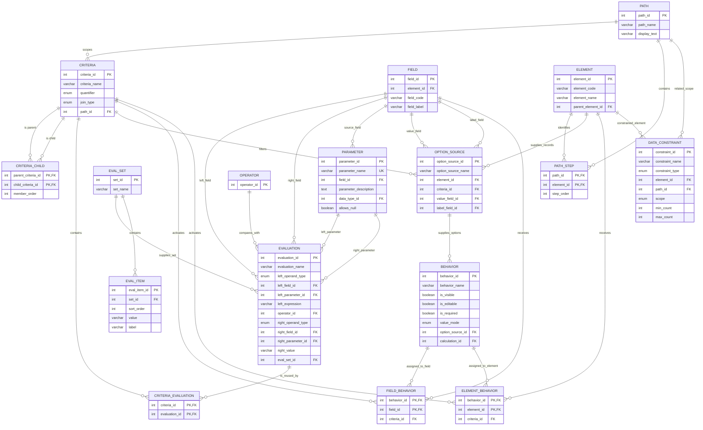

# HMIS.one Criteria Model

## Purpose

This document describes the HMIS.one tables that define reusable criteria, their evaluations, related-record paths, runtime parameters, option sources, and conditional field or element behaviors.

The model separates:

- **Evaluations**, which are individual tests such as `OperatingStartDate <= EventDate`.
- **Criteria**, which combine evaluations and/or child criteria with `AND` or `OR`.
- **Paths**, which identify related record types to inspect.
- **Parameters**, which supply runtime values such as `EventDate`.
- **Consumers**, such as option sources and behavior assignments, which each point to one root criterion.

## Entity relationship diagram



## How the tables work

### `evaluation`

Stores one reusable true-or-false test. An evaluation has a left operand, an operator, and, unless the operator is unary, a right operand.

Examples:

- Field compared with a literal: `ProjectType = 3`
- Field compared with a parameter: `OperatingStartDate <= EventDate`
- Field compared with a set: `ProjectType IN ResidentialProjectTypes`
- Unary test: `OperatingEndDate IS NULL`

`left_operand_type` and `right_operand_type` identify which backing column contains each operand. The API should validate that only the backing column appropriate to the selected type is populated.

### `criteria`

Stores a reusable Boolean group. Its immediate evaluations and child criteria are combined using the criterion's `join_type`:

- `AND`: every immediate member must be true.
- `OR`: at least one immediate member must be true.

A criterion may also contain a `path_id` and `quantifier`. With no path, its members evaluate against the currently bound record. With a path, the criterion evaluates records reached through that path according to its quantifier.

### `criteria_evaluation`

Many-to-many bridge between criteria and evaluations. It lets one criterion contain multiple evaluations and permits an evaluation to be reused by multiple criteria.

Evaluation order is not part of Boolean meaning when all immediate members use the criterion's single `AND` or `OR` operator.

### `criteria_child`

Defines the recursive criteria tree. A parent criterion can contain one or more child criteria, allowing explicit grouping such as:

```text
A AND (B OR C)
```

The write API should reject direct self-reference and longer cycles. `member_order` can support deterministic display, but it does not change Boolean meaning under the current uniform-join model.

### `path` and `path_step`

A path describes how to move from the current record context to another element's records. `path_step` lists the elements traversed in order.

Examples in the current reference point include:

- Any Project
- Project to Funder
- Project to CE Participation

A path-scoped criterion should bind one reached record at a time. All descendants without their own path evaluate against that same reached record.

### Quantifiers

A quantifier specifies how records reached through a path satisfy a criterion:

- `EXISTS`: at least one reached record satisfies the entire criterion.
- `NOT_EXISTS`: no reached record satisfies the entire criterion.
- `ALL`: every reached record satisfies the entire criterion.

For a criterion that checks only the current record, `path_id` and `quantifier` should normally both be null. The current enum also contains `CURRENT`; its durable meaning remains to be reconciled with the null-path convention.

### `parameter`

Defines a named runtime input used by evaluations, such as `EventDate`, `EntryDate`, or `TODAY`.

`field_id` identifies the HMIS field that normally supplies the parameter when there is one. It does not itself provide the runtime value. A caller or higher-level resolver still binds a value when evaluating the criteria tree.

### `eval_set` and `eval_item`

Represent a named set of literal comparison values for operators such as `IN` and `NOT IN`.

The current SQL marks `eval_item` as planned for removal. Until its replacement is defined, consumers should treat it as the current storage for members of an evaluation set, not as the durable API contract.

### `option_source`

Defines a dynamic option list. It identifies:

- the element whose records provide candidate options;
- one root `criteria_id` that filters those candidates;
- the field returned as the option value; and
- the field returned as the option label.

The API should resolve the root criterion recursively rather than reconstructing a separate list of option-source criteria.

### `behavior`

Defines what should happen when a behavior assignment's criterion is true. A behavior can control visibility, editability, requiredness, value mode, a dynamic option source, or a calculation.

### `field_behavior`

Assigns one behavior to one field with one root criterion. The criterion determines when that behavior applies to the field.

The composite primary key of `behavior_id` plus `field_id` means the same behavior can be assigned only once to the same field. Alternative triggering conditions should therefore be represented inside one root criteria tree.

### `element_behavior`

The element-level equivalent of `field_behavior`. It assigns one behavior to one element with one root criterion.

### `data_constraint`

Declares data-level rules that apply to an element, optionally in a related-record path and with a stated scope and cardinality.

The current constraint types are:

- `TEMPORAL_UNIQUENESS`
- `TEMPORAL_CONTAINMENT`
- `CARDINALITY`
- `UNIQUE`
- `REFERENTIAL`
- `VALUE_RELATIONSHIP`

The current structure records the declaration and basic scope but does not yet identify every operand necessary to execute all temporal or relationship constraints generically.

### `field` and `element`

Provide the canonical standards objects referenced by evaluations, parameters, paths, option sources, behavior assignments, and data constraints.

`field_code` and `element_code` are standards-facing metadata that may change. Database IDs currently provide internal identity and foreign-key stability.

## Evaluation flow

A consumer resolves a rule in this order:

1. Start with a root criterion referenced by an option source or behavior assignment.
2. If the criterion has no path, evaluate against the currently bound record.
3. If the criterion has a path, retrieve records reached by that path.
4. Evaluate the criterion's evaluations and child criteria against the appropriate bound record.
5. Combine immediate results using the criterion's `join_type`.
6. If a path was used, apply the criterion's quantifier to the reached-record results.
7. Return the root criterion's final true-or-false result.

## API representation

The public API should return a resolved expression tree rather than exposing only table-shaped rows:

```json
{
  "criteriaId": 43,
  "name": "Project is active and accepting CE referrals on EventDate",
  "join": "AND",
  "scope": {
    "type": "CURRENT_RECORD"
  },
  "evaluations": [],
  "childCriteria": [
    {
      "criteriaId": 42,
      "join": "AND",
      "scope": {
        "type": "RELATED_RECORDS",
        "pathId": 5,
        "quantifier": "EXISTS"
      }
    }
  ],
  "requiredParameters": [
    {
      "parameterId": 1,
      "name": "EventDate",
      "dataTypeId": 1,
      "allowsNull": false
    }
  ]
}
```

