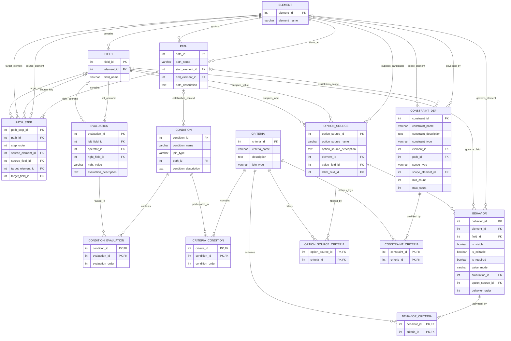

# HMIS.one Conditional Logic Architecture

## Purpose

HMIS.one needs a consistent way to represent conditional applicability, dynamic option lists (e.g., the ones used in the CE Event data element), and data-integrity requirements without embedding element-specific logic in a form, API, report, or CSV implementation.

The proposed model separates three levels of logic:

1. **Evaluation**: one immutable, reusable atomic predicate.
2. **Condition**: one or more evaluations applied to the same record/path context and combined with `AND` or `OR`.
3. **Criteria**: one or more conditions combined into the complete business rule. The criteria description is the display text used in the UI and generated documentation.

Behaviors, option sources, and constraints consume criteria through junction tables. This lets the same logical vocabulary support field and element behavior, dynamic option membership, and canonical data constraints.

## Mermaid ER diagram

> Mermaid uses `CONSTRAINT_DEF` because `CONSTRAINT` can be visually confusing as both a table name and a general database term. The physical table may still be named `ds.constraint`.

## One-page overview for Grant and Zach

### Why this exists

HMIS requirements often contain logic that is more precise than a field name, datatype, or response list can express. Examples include:

- Show Additional Race/Ethnicity only when Race/Ethnicity contains the Other response.
- Populate a project-selection field from the active projects that meet a particular set of requirements.
- Require MoveInDate to fall between EntryDate and ExitDate.
- Permit no more than one HMIS Participation record to be effective for a Project on a given date.

Today, requirements like these may be distributed across prose, forms, CSV specifications, validation tools, or report code. HMIS.one needs a canonical way to represent the logic once so that downstream artifacts can use the same definition.

### The three levels

**Evaluation** is one atomic predicate, such as `ProjectType = 3`, `Race/Ethnicity contains Other`, or `ExitDate is null`. Evaluations are immutable and reusable. If a rule changes, HMIS.one creates or reuses another evaluation rather than editing an evaluation that may already participate in other rules.

**Condition** groups evaluations that operate on the same record context. Each condition specifies:

- the path to the record being evaluated;
- whether its evaluations are combined with `AND` or `OR`; and
- the evaluations that must be applied to that same record.

This is important for related records. A condition using the path `Project → CEParticipationStatus` means every evaluation in the condition applies to the same related CE Participation Status record, rather than allowing separate evaluations to be satisfied by different records.

**Criteria** combines one or more conditions into the complete business rule. The criteria description is the human-readable text displayed in HMIS.one and generated documentation. For the November 6 demo, criteria remain flat: one top-level `AND` or `OR` across their conditions. A future `criteria_group` can support nested criteria if a real requirement cannot be expressed cleanly without it.

### How criteria are used

**Behavior criteria** determine when a behavior applies. A behavior can make an element or field visible, editable, or required; specify whether the value is user-entered, system-generated, or calculated; or select a dynamic option source.

**Option-source criteria** determine which candidate records belong in a dynamically generated list. An option source identifies the candidate element, the field stored as the selected value, and the field displayed as the label. Its criteria filter the candidate records.

**Constraint criteria** express or qualify a canonical integrity requirement. Constraints can represent relationships such as date ordering, temporal containment, uniqueness, and scoped cardinality. Constraint columns such as `scope_type`, `scope_element_id`, `min_count`, and `max_count` describe the structural requirement; associated criteria describe the Boolean logic needed to identify valid or qualifying records.

### Paths make scope explicit

A path defines how HMIS.one moves from the current context to the record being evaluated. If the current context is already Project, a condition testing ProjectType needs no path. If the current context is Enrollment and the requirement refers to the Enrollment's Project, the condition uses `Enrollment → Project`.

Paths are controlled canonical metadata, not arbitrary SQL joins. They make the HMIS relational model explicit and allow the same logic to be documented or projected into forms, APIs, validation tools, and future representations.

### Demo scope versus target architecture

For the November 6 demo, the goal is to show that HMIS.one can represent these requirements explicitly, not to deliver a general-purpose rules engine. The demo can use examples that fit the flat criteria structure and display the resulting condition, behavior, option-source, or constraint metadata.

This sets up a schema where HMIS.one could potentially define reporting specifications. A nested `criteria_group` logic would probably be necessary. A full authoring UI for complex expressions will take some thought. The schema leaves room for expansion.

### Core design principle

> **An evaluation says what to test. A condition says where to test it and how the atomic predicates combine. Criteria state the complete business rule. Behaviors, option sources, and constraints state why that rule matters.**
